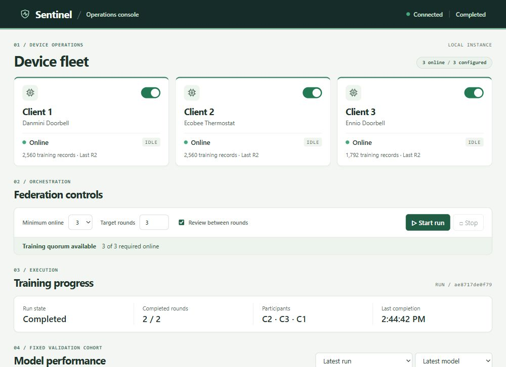
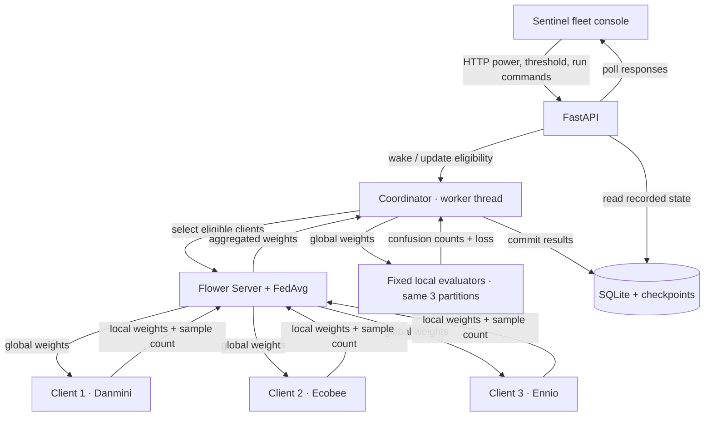

# Sentinel Federated IDS: A Decentralized Privacy Preserving Federated Deep-Learning Framework for Intelligent Intrusion Detection in Heterogeneous IoT Networks

### Federated Intrusion Detection for IoT Networks

[](https://flower.ai/) [](https://pytorch.org/) [](https://fastapi.tiangolo.com/) [](https://sqlite.org/) [](https://react.dev/)



## About

Turn a device on in the fleet to make its local training partition eligible for the next Flower round. Sentinel runs three simulated IoT clients on one computer. Each owns real N-BaIoT records; the console exposes the participants, sample weights, checkpoint and evaluation behind each displayed result. This is a local experiment on captured traffic. Live network monitoring and physical device control are outside its scope.

## Run locally

Tested on Windows with 64-bit **Python 3.14.7**, **Node 24.21.0**, npm 11.19.0, Flower 1.43.0, PyTorch 2.15.0+cpu, FastAPI 0.138.2, React 18.3.1, TypeScript 5.7.3 and Vite 6.4.1. Use one Uvicorn process. Download the dependencies and original dataset once; the demonstration, including Swagger and the data preparation step, runs offline thereafter.

**One-time dataset setup.** Clone the project, then download the original N-BaIoT archive from [UCI](https://doi.org/10.24432/C5RC8J). Extract the ZIP and the attack RAR archives for Danmini Doorbell, Ecobee Thermostat and Ennio Doorbell. Put their device directories directly under `data/raw/` with each device's benign CSV and extracted attack CSVs in the layout shown in the [data guide](docs/data.md).

```sh
git clone https://github.com/SpandanPalit/Sentinel-Federated-IDS.git
cd Sentinel-Federated-IDS
```

The preparation command below selects the demo records from those CSVs and writes one partition per device under `state/prepared/`. Run it once per computer. Later launches reuse those partitions. For an existing dataset elsewhere, substitute `--raw "path/to/device-directories"`.

From the checkout root in PowerShell (no activation or execution policy change needed):

```powershell
py -3.14 -m venv .venv
.\.venv\Scripts\python.exe -m pip install -r requirements.txt
npm.cmd ci --prefix frontend
npm.cmd --prefix frontend run build
.\.venv\Scripts\python.exe -m sentinel.prepare --raw "data/raw"
.\.venv\Scripts\python.exe -m uvicorn sentinel.api:app --host 127.0.0.1 --port 8000
```

Bash equivalents:

```bash
python3.14 -m venv .venv
source .venv/bin/activate
python -m pip install -r requirements.txt
npm ci --prefix frontend
npm --prefix frontend run build
python -m sentinel.prepare --raw "data/raw"
python -m uvicorn sentinel.api:app --host 127.0.0.1 --port 8000
```

Open the [dashboard](http://127.0.0.1:8000/) or [interactive Swagger UI](http://127.0.0.1:8000/docs). Read the [API guide](docs/api.md) or [exported OpenAPI schema](docs/openapi.json). To shut down, stop an active run in the console, then press **Ctrl+C** in the server terminal. Restart with the last command. No account, API key, GPU or Docker installation is needed.

## Try one training round

1. Set **Minimum online** to **3** and **Target rounds** to **2**. Leave **Review between rounds** checked. Power on Client 1 and Client 2; leave Client 3 offline.
2. Select **Start run**. Round 0 evaluates the initial model on all three fixed validation partitions. After initialization the console reads **Waiting for 1 more client · 2 of 3 required online**, with **0 / 2** completed.
3. Power on Client 3. Flower sends the same global parameters to all three trainers, receives their updates, and commits Round 1. Inspect **R1** in history, expand **Confusion matrix & per-client results**, and compare the checkpoint identifier with the round API.
4. At the review boundary, turn Client 3 off, then click **Continue to next round**. Even after refreshing, Round 1 remains available while training waits. Restore Client 3 to complete Round 2 automatically. The final reserved-test result is under `test` in the run API. Disable review for unattended continuous training.

## Architecture



The local transport adapts Flower `ClientProxy` to a `NumPyClient.to_client()` instance per partition. Flower's `Server.fit_round` dispatches FitIns messages, collects FitRes messages and calls the strategy. The subclass gates selection and eligible replies, then calls Flower's own FedAvg aggregation. All clients run in-process; dispatch is limited to one worker on this CPU demo. PyTorch trains a 115 → 64 → 32 → 2 MLP with hidden ReLUs, two raw logits, integer class labels and cross-entropy. Prediction uses argmax. Demo defaults: Adam, learning rate 0.001, batch 64, one epoch, seed 42. The API accepts all of these training settings except optimizer choice.

For one parameter, values **0.2** and **0.8** from clients with **100** and **300** local records yield **(100 × 0.2 + 300 × 0.8) / 400 = 0.65**. Flower applies that operation to each corresponding weight and bias. Training multiple epochs does not multiply a client's weight.

All online trainers are selected at dispatch. The persisted attempt freezes the quorum and selection. A power transition invalidates that training lease, even if the client is quickly powered back on. Each local batch checks the lease; a final reply check excludes disconnected clients. The same minimum must be met by accepted replies. An insufficient attempt keeps the prior model, records failures, and retries the same round number. Availability changes after the acceptance boundary apply to future dispatches. A stop cancels uncommitted work; restarting the service marks a previously active run interrupted and retains committed checkpoints.

## Data and measured results

The locally prepared **demo** profile contains a small, attributed subset of [N-BaIoT from UCI](https://doi.org/10.24432/C5RC8J). [Data preparation and provenance](docs/data.md) covers local source directories, manual extraction, offline reproduction, the exact column order and inference. Use `python -m sentinel.prepare --raw "data/raw"` to prepare from extracted originals. Separate attack CSVs are assigned as groups. Single ordered benign captures use contiguous blocks separated by 128 observations in this profile. Each device fits its own scaler on training rows only. A global, pre-scaling duplicate audit removed 8 validation and 14 test rows matching earlier splits.

| Client | Device | Training | Validation | Reserved test |
|---|---|---:|---:|---:|
| 1 | Danmini Doorbell | 2,560 | 768 | 768 |
| 2 | Ecobee Thermostat | 2,560 | 768 | 768 |
| 3 | Ennio Doorbell | 1,792 | 504 | 498 |
| **Total** | | **6,912** | **2,040** | **2,034** |

**Recorded browser run `cc9680438496`.** The fixed validation cohort contains 768 benign and 1,272 attack records. Always predicting the training majority (attack) scores **62.353%**. Round 0 is the untrained model, separate from that constant predictor and excluded from completed rounds.

| Global model | Validation accuracy | Validation loss | Attack F1 | L2 weight change |
|---|---:|---:|---:|---:|
| Round 0 | 65.980% | 0.65066 | 78.567% | 0 |
| Round 1 | 99.902% | 0.08740 | 99.921% | 1.73797 |
| Round 2 | 99.902% | 0.00968 | 99.921% | 1.14914 |

At Round 2, **TN 767, FP 1, FN 1, TP 1,271** give (767 + 1,271) / 2,040 = 99.902%. The two trained models made the same *number* of errors; their losses, parameter changes and checkpoint hashes distinguish them. An unchanged confusion matrix alone cannot tell whether the same individual rows were misclassified. The final model scored **99.508%** on the separate 2,034-record test cohort (9 missed attacks, 1 false alarm). This measures selected prefixes from three known devices. Capture-specific patterns, repeated observations within splits and correlated time windows limit generalization; this is not an estimate of deployment accuracy.

The main chart uses only full fixed-cohort evaluations. Offline trainers still have a separate, readable local validation partition on this host. A failed evaluator is recorded with coverage and a partial/unavailable label. Pooled precision, recall and F1 use summed confusion counts with attack positive; loss is averaged by evaluated records. Undefined ratios serialize as null and display as **—**. Training loss is stored separately. Validation can inform configuration decisions; avoid selecting configurations on final test scores.

## Inspect and verify

- `sentinel/prepare.py` creates the cohort; `sentinel/federation.py` contains the model, clients and Flower strategy. `sentinel/service.py` owns scheduling and transactions; `sentinel/api.py` exposes the HTTP interface. `frontend/src/` contains the operator console.
- `state/sentinel.sqlite3` stores settings and run JSON snapshots. `state/checkpoints/<run-id>/round-NNN.npz` stores ordered global parameters. SHA-256 of each checkpoint equals its model version. The run also records the manifest fingerprint, per-device partition hashes, counts, configuration, attempts, validation results and final evaluation.
- `state/prepared/manifest.json` maps friendly IDs to original devices and file ranges. Keep the prepared directory unchanged while the service is running. For another experiment, prepare into a fresh directory with `--output PATH/prepared` and set `SENTINEL_HOME` to `PATH` before launch.
- [Verification record](docs/verification.md) links to the actual browser-run measurements. No fixture scores are used in the console or these figures.

In a second PowerShell terminal, from the checkout root:

```powershell
.\.venv\Scripts\python.exe -m pytest -q
npm.cmd --prefix frontend run build
.\.venv\Scripts\python.exe -m scripts.smoke
```

On Bash use the activated environment's `python` and `npm`. The smoke test operates the running local API, sets fleet power, runs two real training rounds and leaves the recorded result available. It refuses to take over an active run. Unit/integration tests use temporary directories and synthetic fixture records.

## Privacy and future work

Training inputs remain with their assigned logical client. Flower exchanges model parameters, example counts and local mean training losses. Local evaluators return aggregated confusion counts and losses. Preparation has access to all source files for the overlap audit. All components share one trusted host and process: this is logical separation, not an access-control boundary. Updates may reveal information. Differential privacy, secure aggregation, authenticated remote clients and encrypted transport are not implemented. Use the loopback binding for the demonstration.

Future work includes testing on unseen devices and later captures, Raspberry Pi gateways hosting local models for connected IoT devices, authenticated network transport, privacy-preserving aggregation and Docker packaging.
